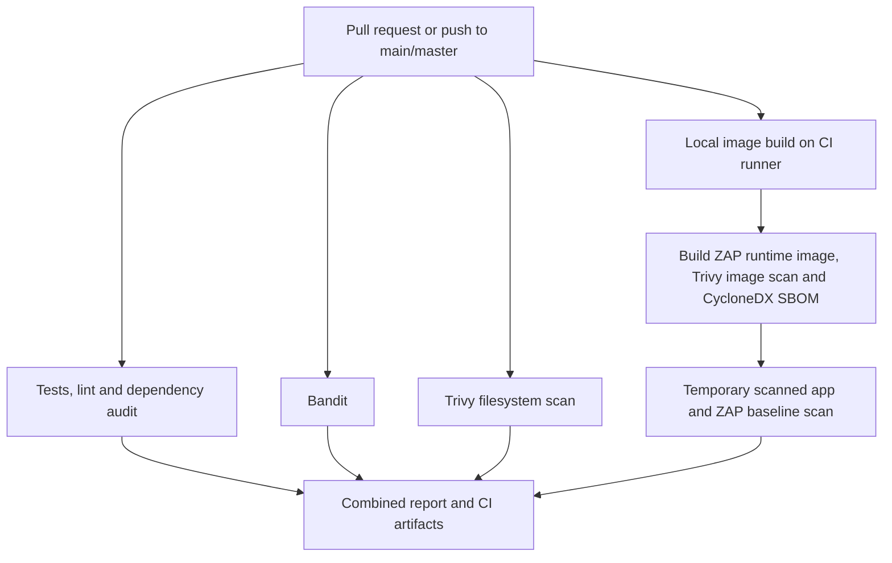

# AI DevSecOps Starter Platform

A demonstration FastAPI service and DevSecOps validation pipeline with deterministic
text-risk heuristics, container builds, infrastructure configuration scans and
consolidated reports. No LLM or external AI service is integrated.

**Production readiness: NO GO.** Five SQLite/OpenSSL CVE dispositions and deployment
controls remain unresolved. Kubernetes and Terraform files are templates requiring
environment-specific configuration and review; passing CI does not authorize deployment.

Start with [local setup](#local-setup). For release decisions, see the
[readiness checklist](docs/production-readiness.md) and
[SQLite/OpenSSL review](docs/sqlite-openssl-dispositions.md).

## Key Capabilities

- FastAPI application with hardened security headers
- Non-root Docker runtime with a pinned base image
- GitHub Actions validation pipeline; no automated deployment or image publishing
- Automated unit testing with Pytest
- SAST scanning with Bandit
- SCA and IaC scanning with Trivy
- DAST scanning with OWASP ZAP
- Terraform infrastructure examples
- Kubernetes deployment manifests
- Consolidated DevSecOps report generation
- Test and scan report uploads to GitHub Actions artifacts

The analyzers provide heuristic indicators, not a complete security scanner,
semantic understanding of prompts, or a compliance certification.

## Security Controls

- X-Content-Type-Options
- X-Frame-Options
- Referrer-Policy
- Permissions-Policy
- Cross-Origin-Resource-Policy
- Cache-Control

---

## Architecture



These jobs validate changes. They do not push container images, apply Kubernetes
manifests, run Terraform plans/applies, or provision cloud resources.

---

## Local Setup

Use Python 3.12, matching CI. Docker with the Compose plugin is needed only for
the container workflow. Run the following commands from the repository root.

### 1. Clone repo

```bash
git clone https://github.com/pfoseh-ops/ai-devsecops-platform.git
cd ai-devsecops-platform
```

### 2. Create Python virtual environment

```bash
python -m venv .venv
source .venv/bin/activate   # macOS/Linux
```

In Windows PowerShell, activate with:

```powershell
.\.venv\Scripts\Activate.ps1
```

### 3. Install dependencies

```bash
python -m pip install -r requirements.txt -r requirements-dev.txt
```

`requirements.txt` includes runtime and test dependencies; `requirements-dev.txt`
adds lint and security tools. The Docker runtime installs only
`requirements-runtime.txt`.

### 4. Run the app

```bash
python -m uvicorn src.app.main:app --reload --host 127.0.0.1 --port 8000 --no-access-log --log-config config/logging.json --no-proxy-headers
```

Local mode is anonymous unless `API_KEY` is configured. Use synthetic prompts;
do not enter live credentials. Reload mode is for development only.

Open:

```text
http://localhost:8000/health
```

Swagger API Docs:

```text
http://localhost:8000/docs
```

---

## Run With Docker

```bash
docker compose up --build
```

Compose uses local mode and binds to `127.0.0.1:8000`. Stop with Ctrl+C and run
`docker compose down` to remove the local containers/network.

Open:

```text
http://localhost:8000/health
```

Swagger API Docs:

```text
http://localhost:8000/docs
```

---

## Run Tests

```bash
python -m pytest -q
python -m ruff check src scripts tests
python -m bandit -r src scripts
python -m pip_audit -r requirements.txt -r requirements-dev.txt
```

Bandit currently reports LOW `B404` on the operator helper's subprocess import,
so the unfiltered local command returns a finding exit status. CI separately gates
HIGH severity **and** HIGH confidence; that policy is not a production risk acceptance.

The [November 24, 2026 CI run](https://github.com/pfoseh-ops/ai-devsecops-platform/actions/runs/45362760211)
passed 78 tests, lint, dependency audit, build, Bandit, Trivy, ZAP and report generation.
ZAP retained one warning type, Non-Storable Content, on two responses; the API
deliberately sets `Cache-Control: no-store`. These results describe that commit,
not a guarantee about future builds or production controls.

## API contract (1.1)

`POST /analyze` accepts a JSON object with a required string `prompt`.
The prompt must contain a non-whitespace character and be at most 10,000
characters **before trimming**. This bounds work for the small regex analyzer
while allowing multi-paragraph descriptions. The HTTP body is separately limited
to 131,072 bytes, including chunked bodies; this accommodates JSON-escaped Unicode.
Missing, blank, non-string, malformed JSON, and oversized prompts return 422 with
`detail: [{loc, msg, type}]`. Bodies over the byte limit return 413.

Successful responses contain `risk` (low/medium/high), `score` (0–100), `signals`,
`frameworks`, and `recommendation`. **The former `input` field is removed** to avoid
echoing credentials or other sensitive text. Clients must stop reading `input`;
if needed, retain their own submitted text securely. Repository tests are updated;
there is no separate frontend client in this repository. Validation errors omit
submitted values and exception context. Prompts are processed in memory, not
persisted or intentionally logged. Do not submit live credentials.

The reported S3 example now produces `public_cloud_exposure`, `exposed_credentials`,
and `disabled_security_monitoring`, with high risk. Existing hardcoded-secret,
public-exposure, IAM, privilege, and container heuristics are preserved. New phrase
rules include common word orders and local negation, but cannot interpret arbitrary
natural language. Scores are heuristics, framework labels are contextual references,
and neither this endpoint nor the IaC demo is a complete security scanner or proof
of compliance. Existing broad keywords can still produce false positives.

`GET /` returns `message` and `status`; `GET /health` returns `status`, `service`,
and a UTC `timestamp`. Response models and validation constraints are published
at `/docs` and `/openapi.json`. Analysis errors also document 401, 413, 429, and 500.

## Production requirements and remaining decisions

This repository is a demo baseline, not a configured production deployment.

Use the [production deployment readiness package](docs/production-readiness.md)
for the blocker/owner matrix, exact verification steps, evidence requirements,
pending security dispositions, and separate deployment/traffic approval checklists.

- **Authentication/authorization:** local/test mode remains anonymous unless
  `API_KEY` is set. Set `ENVIRONMENT=production`; startup then requires an API key
  of at least 32 bytes. Generate a high-entropy random key, store it in a secret
  manager, and send it in `X-API-Key`, never in the URL. A configured key protects
  `/analyze` in every mode. This shared key grants the same capability to every
  holder; user identity, tenant isolation, RBAC, rotation, and revocation policies
  require a gateway/identity-provider decision. Health, root, and API docs remain
  unauthenticated at the application; restrict their exposure at the gateway.
- **Kubernetes:** the example references Secret `ai-devsecops-api`, key `api-key`,
  and explicitly enables production mode. Provision that secret outside source
  control using `scripts/sync_api_secret.py` and replace the image marker with a tested
  immutable digest. The sync script is an operator action, not a build/startup hook.
  The pod template specifies UID/GID 10001, a read-only root filesystem, runtime-default seccomp,
  and no mounted service-account token. `k8s/namespace.yaml` defines `ai-devsecops`
  with restricted Pod Security Admission. Trivy's built-in rule allows the `ghcr.io`
  registry host; a configuration test additionally requires the exact repository
  owner's `ghcr.io/pfoseh-ops/` prefix. Enforce that narrower policy at admission too.
- **HTTPS/networking:** terminate TLS at an approved ingress or reverse proxy,
  redirect HTTP there, configure HSTS and trusted hosts, and restrict direct pod
  access. Trust forwarded headers only from that proxy, not arbitrary clients.
  Ingress and NetworkPolicy templates now exist under `k8s/`; their gateway class,
  selectors, hostname, and TLS certificate still require configuration. Local
  Compose and `make run` bind to loopback; container port 8000 is internal HTTP.
- **Limits:** a bounded in-memory fallback allows 60 analysis requests per minute
  per process (including rejected requests), returning 429 with `Retry-After`.
  It resets on restart, is shared by callers, and is not coordinated across pods
  or workers. Configure identity-based quotas, concurrency limits, header/body
  limits, and slow-request/read timeouts at the gateway before public exposure.
  Body size limits alone do not prevent slow clients or connection exhaustion.
- **Logging/errors:** application logs contain route templates and status codes,
  not bodies, keys, raw URLs, or exception text. `config/logging.json` enables INFO
  for `src.app.security`. Arrange retention, access control,
  monitoring, and alerting. Unexpected errors return generic JSON 500 responses.
  Docker/Makefile disable Uvicorn access logs because query strings can contain
  secrets; use the same `--no-access-log` option with custom commands. Ensure ingress,
  tracing/APM, and log collectors also redact bodies, headers, query strings, and
  exception locals. External logging configuration is not verified by unit tests.
- **Health:** `/health` is an unauthenticated process-liveness check, exempt from
  analysis quotas; the stateless analyzer currently has no external dependencies.
  Add dependency-specific readiness checks if storage or model services are added.
- **Dependencies:** FastAPI/Starlette and Pytest were upgraded after a dependency
  audit identified vulnerable versions. CI runs dependency auditing, lint, unit
  tests, and Bandit. The Docker base is digest-pinned, but OS updates and transitive
  Python dependencies still resolve at build time. Audit them again for a release,
  scan the exact built image, and
  establish an update policy. Passing these checks does not certify security.
- **Terraform artifact storage:** the configuration proposes versioning, SSE-KMS
  with automatic key rotation, HTTPS-only access, disabled ACLs, and access logging
  to a separate same-account/same-region bucket. These are not verified live resources.
  Review the procedures below before
  applying; no cloud resources or state migrations were performed.

### Production deployment procedure (not executed)

1. Choose the AWS account/region, DNS hostname, existing gateway/controller class,
   identity provider, and approved image digest. Replace every `replace-with-*`,
   `REPLACE_WITH_*`, and `example.invalid` marker in `k8s/`. Do not apply templates
   unchanged. Provision namespace `ai-devsecops` before its namespaced resources.
2. On the existing TLS gateway, configure a publicly trusted certificate for the
   chosen hostname (or an internal CA trusted by every client), TLS 1.2/1.3 only,
   automatic renewal with expiry alerts, an HTTP-to-HTTPS 308 redirect, and HSTS
   after HTTPS is verified. Populate `ai-devsecops-tls` through your certificate
   manager; never commit a private key. Generic Kubernetes Ingress does not enforce
   redirects, cipher policy, authentication, or quotas: configure and verify these
   in the actual controller. Only exact `/analyze` is exposed; docs/health stay internal.
3. Set a 128 KiB gateway body limit, bounded headers, 10-second client-header/body
   timeouts and a 15-second upstream response timeout as starting values; load-test
   before approving them. Disable body buffering to disk if supported, request-body
   tracing, and request/response capture. If temporary buffers are unavoidable,
   use encrypted ephemeral storage with restricted access and retention.
4. Align `k8s/network-policy.yaml` namespace AND pod selectors to the approved
   gateway. Verify your CNI enforces the policy and node probes still work. Egress
   is denied because the analyzer needs no external network. The application
   disables proxy headers and does not use forwarded identity/IP for authorization.
   If client-IP attribution becomes necessary, configure only verified proxy CIDRs.
   Internal service traffic is HTTP: if your threat model requires in-cluster
   confidentiality, enable existing platform mTLS and verify it before release.
5. Restrict direct pod/service access, port-forward permissions, and Secret reads.
   Use existing cluster admission to allow `ghcr.io/pfoseh-ops/` and require immutable
   digests and signed images. Trivy's allowlist is a static check, not enforcement;
   verify pull credentials, provenance, and the exact image's vulnerability report.
6. Before release, verify valid/expired certificate behavior, HTTP redirects,
   wrong-host rejection, unauthenticated/unauthorized requests, quotas across BOTH
   replicas, denial from an unrelated pod, secret rotation, and synthetic-marker
   log searches. None of those live controls is certified by local validation.

### Artifact storage decisions and migration

Set `artifact_bucket_name` to the existing bucket's name when migrating, and choose
a distinct globally unique `access_log_bucket_name`. Review an authenticated plan
in the correct account with an encrypted, access-controlled remote state backend;
no backend or account credentials are configured by this review. Import existing
resources where necessary; never accept unexpected replacement. `prevent_destroy`
protects both buckets and the KMS key, but is not a backup or an IAM control.

The artifact KMS key delegates access through account IAM. Scope publisher/reader
roles to this key and bucket, and review key-administrator permissions. Bucket keys
reduce KMS request costs. Default encryption covers NEW uploads; re-encrypt existing
objects separately if required. Versioning adds storage cost and keeps old versions;
artifact deletion/lifecycle policy requires an explicit retention decision.

Both buckets disable ACLs; review/migrate existing ACL-dependent publishers before
applying that change. The log sink is versioned, private, HTTPS-only and BucketOwnerEnforced. Only
`logging.s3.amazonaws.com`, restricted by source account/bucket, can deliver to
`s3-access/`. Proposed retention is 365 days (current and noncurrent versions each
expire on their own clock, so total retention can be longer); get policy approval.
Access logs are best-effort and may contain object names, request paths, or other
sensitive metadata. Do not encode secrets in object keys or presigned URLs in logs;
restrict access and use existing CloudTrail audit controls where completeness is required.

Two findings remain visible without scanner suppressions: `AWS-0089` on
`aws_s3_bucket.access_logs` (the log sink is not itself logged) and `AWS-0132` on
`aws_s3_bucket_server_side_encryption_configuration.access_logs` (the proposed
direct S3 server-access-log destination uses SSE-S3). See the
[AWS delivery/encryption requirements](https://docs.aws.amazon.com/AmazonS3/latest/userguide/enable-server-access-logging.html).
If your organization mandates KMS for all logs, use an approved alternative logging
pipeline instead of disabling the rule without review. Exceptions require an owner,
approval and review date before production.

### Secret source and rotation

The deployment contains a `secretKeyRef`, not a credential. To make AWS Secrets
Manager the source of truth, provision a raw single-line, cryptographically random
key of at least 32 bytes there using an approved operator workflow. The repository
does not contain the real secret ARN, account credentials, or a deployed secret.
Grant the operator `secretsmanager:GetSecretValue` for that one ARN (and `kms:Decrypt`
for its key if required) plus narrowly scoped Kubernetes Secret write permissions.
The API pod needs neither AWS credentials nor Kubernetes API access.

The following is an explicit deployment action for a future authorized operator;
it was NOT run during this review:

```bash
python scripts/sync_api_secret.py --secret-id "$APP_SECRET_ARN" --context "$APP_CLUSTER_CONTEXT"
```

The helper reads `AWSCURRENT` through the AWS CLI and passes the key to kubectl over
stdin, without a shell, plaintext temporary file, command-line value, or stdout
echo. Server-side apply avoids a last-applied annotation containing a second copy.
Kubernetes still stores a copy: verify etcd/envelope encryption, narrow RBAC, and
audit policies that record Secret requests at **Metadata** level, never bodies.
Disable operator terminal recording/debug tracing and CI command capture for this
step. If your platform already has a secret-sync controller, use it instead of
adding another operator; keep the same target Secret name/key.

Rotation procedure: temporarily stop new analysis requests at the gateway; create
a new random Secrets Manager version and promote it to `AWSCURRENT`; run the sync
helper; perform and wait for a rolling restart of deployment `ai-devsecops-demo` in
namespace `ai-devsecops`; update approved clients/gateway credentials through their
secret manager; verify every replica accepts the new key and rejects the old key;
then reopen traffic and retire the old version according to policy. Environment
variables are read only at startup, and the app accepts one key, so zero-downtime
overlap is NOT supported. For a suspected leak, revoke first and accept the outage.
Do not roll back to a known-compromised version. Verify this in staging first.

### Identity, quotas, and log verification

A shared API key has no individual identity, role, scope, tenant boundary, expiry,
or individual revocation. Length checks do not guarantee entropy. Prefer the
existing gateway + organization identity provider: validate token signature,
issuer, audience, expiry and `devsecops:analyze` scope; map the analyst role to that
scope and deny others. Strip caller-supplied identity headers, authenticate upstream
calls using a gateway-held API key, always overwriting caller-supplied `X-API-Key`,
and prohibit bypass paths. Reuse the gateway's
managed, identity-based distributed quota service. Add Redis or another limiter
only if the existing platform cannot provide a required quota; no new service is
provisioned here. The local 60/minute deque is shared by all callers, resets on
restart, differs per process/pod, and can let an anonymous caller consume capacity.
It is only a fallback, not an authorization or distributed-abuse control.

Application tests check response and log privacy for bodies, validation failures,
headers, queries and unmatched paths. The Docker logging configuration suppresses
Uvicorn access logs. At the gateway, record only a server-generated request ID,
route ID, status, duration, and approved opaque actor ID. Never log raw request
lines, query strings, headers (`Authorization`, `X-API-Key`, cookies), bodies,
exception locals, or WAF request samples for this route. Disable tracing payload
capture; enforce collector allowlists rather than trying to regex-redact every
possible secret. Configure access/retention and alerting separately.

For deployment verification, send a unique **synthetic** marker in a prompt, header,
query and invalid request; inspect gateway access/error logs, WAF, APM/traces,
cluster audit logs and external collectors. The marker must not appear anywhere
outside the test client's own storage. Also test the failed-secret-sync path.
Those systems were not accessed here, so external log privacy remains unverified.

### Local production-review evidence

Raw scan output, image archives, generated manifests, downloaded source snapshots
and other `reports/` evidence are local-only and excluded from Git. Paths below
identify review artifacts that are not included in a fresh clone. Sanitized
conclusions are in `docs/`; CI uploads its own fresh reports as workflow artifacts.

Trivy is pinned to 0.76.2 in CI. Reproduce the source scan with
`trivy fs --config trivy.yaml --format json --output reports/production-review-final.json .`.
The configuration excludes deliberately insecure examples, generated reports,
virtual environments, and Terraform provider downloads. Those exclusions are not
a claim that every file in the repository is secure. Dependency audits separately
resolve transitive Python dependencies.

CloudFront check `AWS-0010` now executes: the unlogged synthetic distribution
`aws_cloudfront_distribution.without_logging` fails, and the logged fixture passes
(`reports/cloudfront-check.json`). There is no CloudFront resource in the application
Terraform, so the rule is not applicable to its actual architecture. Fixtures under
`reports/cloudfront-fixtures` are for scanning only and must never be applied.

An earlier `gitleaks git --log-opts=--all --redact` review scanned 26 then-local commits and
flagged `hashicorp-tf-password` at `examples/insecure/bad-main.tf:21` in commits
`50c01ec5b34fd0fbffcc8a0bcac89b554845b652` and
`11f38303019a6bd679c394093567b90ed0146989`. These are intentionally insecure teaching
fixtures, not the new API-key source. Confirm their values were never real credentials;
if they were, revoke them first and follow the repository's incident/history-cleanup
process. History was not rewritten. A pattern scan cannot prove absence of all
secrets, and remote-only/unreachable history was not inspected.

Bandit reports one LOW `B404` on the sync helper's subprocess import. That helper
uses fixed tools resolved from the trusted operator PATH, argument arrays without
a shell, stdin for values, captured output and generic errors. The call's `B603`
is locally annotated after review; the import finding remains visible. Run this
operator helper only on a trusted host with trusted AWS CLI/kubectl binaries.

The demo IaC scanner reports `TF-AWS-S3-POL-001` on `terraform/main.tf` because its
text rule sees `Principal = "*"` in the explicit **Deny**-insecure-transport policies.
Those statements deny access rather than grant public access. Trivy's semantic
policy scan is used for this review; the demo rule and its false positive remain
visible rather than weakening the TLS policy to obtain a green result.

Terraform validation is local/schema-only, without a plan or an AWS account check.
The Kubernetes API, CNI, gateway, certificates, IAM permissions, actual log delivery,
remote secret contents, and external logs have not been verified. **Not production-ready.**

---

## Run DevSecOps Scan

```bash
python -m src.ai_guard.scan --target . --output reports/devsecops-report.md
```

Then open:

```text
reports/devsecops-report.md
```

---

## Demonstrate Intentional Scanner Findings

This repo includes [deliberately insecure teaching fixtures](examples/insecure/README.md)
for demonstrating rule findings and remediation workflows. Never apply these files
to a cluster or cloud account. A failed demo scan is not a compliance assessment.

```bash
python -m src.ai_guard.scan --target examples/insecure --output reports/insecure-report.md --fail-on high
```

You should see violations such as:

- Public S3 bucket risk
- Kubernetes container running as privileged
- Missing CPU/memory limits
- Image using `latest` tag

The command intentionally exits nonzero when it finds HIGH-or-greater issues.

---

## GitHub Actions

The workflow is located here:

```text
.github/workflows/devsecops.yml
```

It runs on pushes to `main`/`master` and pull requests targeting a branch matched
by the workflow filter. A feature-branch push alone does not trigger it; a push
to an open PR also produces a PR synchronization event. The token has
`contents: read` permissions.

The workflow performs:

1. Python dependency installation
2. Unit tests, lint and Python dependency auditing
3. SAST with Bandit
4. SCA and IaC scanning with Trivy
5. Docker image build validation
6. Runtime image vulnerability scanning, CycloneDX SBOM generation and DAST with OWASP ZAP
7. Consolidated report generation
8. Uploads of test/security reports as GitHub Actions artifacts

The SCA job scans the **filesystem**. The runtime/ZAP job additionally scans the
exact final image archive with Trivy 0.76.2 and converts that result into a CycloneDX
SBOM before starting the same image for ZAP. It verifies the scanned layer list and
platform against the built image and records the source commit, image/configuration
identities, database timestamps, package inventory, occurrence/unique-ID counts and
evidence hashes. Missing or inconsistent evidence and scanner/tool failures fail CI.

Download `runtime-image-security` from the workflow's artifacts for the JSON scan,
CycloneDX SBOM, identity, summary and scanner/database metadata (14-day retention).
The image archive is not uploaded and no image is pushed to a registry. The summary
also appears in the job summary and combined report. The runtime scan covers OS
and application dependency vulnerabilities; repository secret scanning remains in
the filesystem job. Neither scan replaces manual advisory review.

Both Trivy scans are report-producing, so success does not mean zero findings or
production approval; unfixed findings and all severities remain included.
ZAP tests a temporary runner-local service and permits warning-level
findings with `-I`; scan failures are not blanket-ignored. The combined report
retains **NO GO** even when all validation jobs pass.

---

## How This Maps to Enterprise DevSecOps

| Stage | What This Repo Demonstrates |
|---|---|
| Plan | Documented security checks, owner decisions and release blockers |
| Code | FastAPI app + tests |
| Build | Docker image build |
| Secure | Automated scan of Terraform and Kubernetes artifacts |
| Deploy | Unapplied Kubernetes/Terraform templates; deployment is not automated |
| Operate | Health endpoint and declared resource limits; live enforcement unverified |
| Feedback | Markdown report generated for engineers/security teams |

---

## Runtime image and review status

The Dockerfile uses a digest-pinned official Python 3.12/Alpine 3.24 base and a
multistage build. Runtime excludes pip, pytest, HTTPX and rich; the separate
`test-tools` target exports test dependencies for isolated testing. Native wheels
are required during the build. Local virtualenv workflows remain unchanged.

The [image investigation](docs/image-vulnerability-review.md) records the Debian
baseline's 222 occurrences and the Alpine rebuild's zero scanner matches. The
[five-CVE follow-up](docs/sqlite-openssl-dispositions.md) explains why the zero
result is not a security clearance: SQLite/OpenSSL features remain, fixes were not
verified in Alpine 3.24, and the tested API paths only establish bounded reachability
evidence. Production controls and these dispositions remain open: **NO GO**.

For a local image scan, install the project's reviewed Trivy version (0.76.2) and run:

```bash
python -c "from pathlib import Path; Path('reports').mkdir(exist_ok=True)"
docker build --pull -t ai-devsecops-review:local .
docker image save --output reports/runtime-image.tar ai-devsecops-review:local
trivy image --input reports/runtime-image.tar --scanners vuln,secret --list-all-pkgs --format json --output reports/runtime-image-scan.json
trivy convert --format cyclonedx --output reports/runtime-image-sbom.cdx.json reports/runtime-image-scan.json
```

These commands build and scan locally;
they do not publish an image. Refresh the scanner database and base deliberately,
record the resulting digest, and review vendor advisories as well as scanner matches.
Changing a base or dependency can invalidate earlier evidence.

## Potential Future Enhancements

These options are not implemented or approved commitments:

- Define an owner-approved image release policy and build provenance/signature verification;
  runtime scanning and CycloneDX SBOM generation are now automated in CI.
- Evaluate additional IaC analysis if it fills a documented gap in the existing checks.
- Consider Argo CD, ECR image publishing or EKS deployment automation only after
  architecture review and separate publication/deployment authorization.
- Integrate metrics and alerts with the existing observability platform, such as Prometheus/Grafana.
- Implement and verify admission policies using the platform's chosen policy engine,
  such as OPA or Kyverno; static manifests do not prove enforcement.
- Consider an OpenAI/Azure OpenAI explanation layer only after privacy, retention,
  secret-redaction and data-egress decisions. Prompts may contain sensitive information.

---

## Author

**Paul Foseh**

Senior DevOps & Cloud Engineer | Infrastructure as Code | CI/CD Automation | Kubernetes & Platform Engineering
